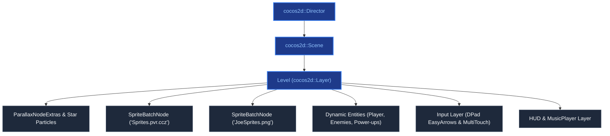

# Cocos2d-x Engine & Scene Graph

Space Quest is built upon the C++ **Cocos2d-x** engine, adopting its node hierarchy and action pipeline.

---

## 1. Director & Scene Lifecycle

The game lifecycle is driven by `cocos2d::Director::getInstance()`, which manages the main loop (updating game logic, running actions, and rasterising nodes to OpenGL at 60 FPS):

* **`runWithScene(cocos2d::Scene* scene)`**: Called in `AppDelegate::applicationDidFinishLaunching()` to load the initial scene (`SignInScene` on Android or `SplashScene` on desktop).
* **`replaceScene(cocos2d::TransitionScene* transition)`**: Replaces the active scene using animated scene transition controllers (such as `TransitionFade`, `TransitionSlideInB`, `TransitionZoomFlipX`, and `TransitionRotoZoom`), ensuring old scene layers and textures are disposed cleanly.

---

## 2. Node Hierarchy & Layering

Every active state in the game is represented as a `cocos2d::Scene` composed of specialized `cocos2d::Node` and `cocos2d::Layer` instances:

1. **Parallax Background Layer (`ParallaxNodeExtras`)**: Renders multi-tiered starfields scrolling at varying velocity multipliers to create optical depth, supplemented by `ParticleSystemQuad` star emitters.
2. **Batched Entity Layer (`SpriteBatchNode`)**: Houses active entities (`Player`, `EnemyShip`, `Laser`, `Asteroid`) blitted from shared texture atlases.
3. **Control Layer (`DPad`)**: Contains the on-screen capacitive virtual D-Pad (`EasyArrowsx-3.0`) and touch listeners for mobile play.
4. **HUD & UI Layer (`HUD`, `MusicPlayer`)**: Displays real-time status bars, timers, score counters, and audio jukebox controls.

!!! tip "Performance Optimisation: Sprite Batching"  
    Using a shared texture atlas with `SpriteBatchNode::create("Sprites.pvr.ccz")` and `SpriteBatchNode::create("JoeSprites.png")` allows dozens of simultaneous laser beams, particles, and enemy sprites to be rasterised in a single OpenGL draw call.
