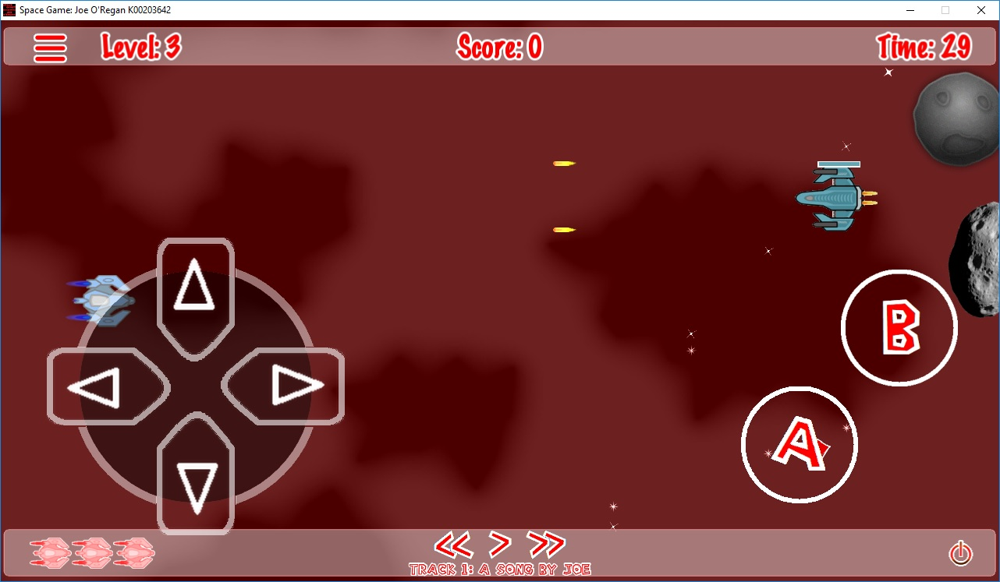

# Input & Control Systems

To ensure seamless cross-platform playability, Space Quest implements separate desktop and mobile input listeners that translate hardware events into uniform ship velocity.

---

## Desktop Input (Win32)

* **Movement**: `W`, `A`, `S`, `D` or Arrow Keys.
* **Single Laser**: `Spacebar`.
* **Double Laser**: `Left Control`.
* **Pause / Menu**: `Escape` key.

## Mobile Input (Android)

* **Virtual D-Pad**: Integrated using [EasyArrowsx-3.0](https://github.com/joeaoregan/EasyArrowsx-3.0), providing multi-directional touch tracking.
* **Fire Buttons**: Dedicated on-screen touch buttons for primary laser and upgraded double-laser fire.

!!! important "Multi-Touch Handling"  
    Mobile controls use `EventListenerTouchAllAtOnce` to ensure players can steer via the virtual D-Pad while simultaneously pressing the fire button without touch cancellation.
