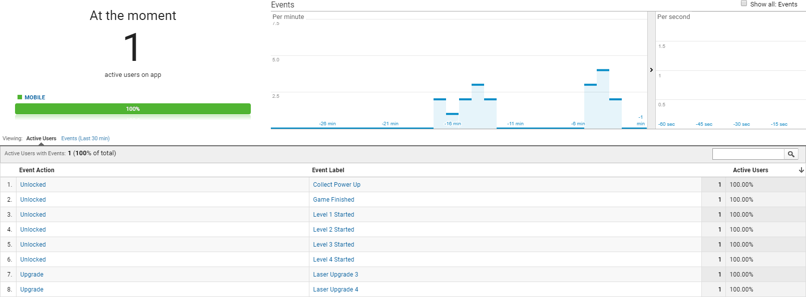
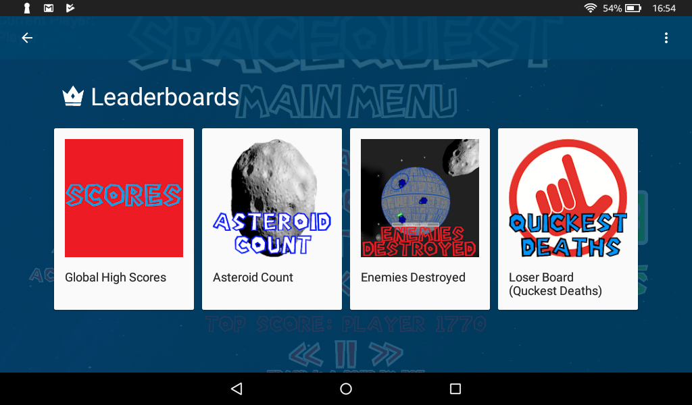

# SDKBox Cloud Services & Analytics

Space Quest uses **SDKBox** to integrate native mobile SDKs into C++ with zero Java boilerplate.

###### Google Analytics Dashboard

###### Google Play Leaderboard

---

## 1. Google Analytics (`PluginGoogleAnalytics`)

* **Session Tracking**: Logs user launches, active playtime, and retention.
* **Event Logging**: Captures level start/completion, player deaths, and weapon upgrades.
* **Funnel Analysis**: Tracks how many players progress from Level 1 to the Level 2 Boss.

## 2. Google Play Games Services (`PluginSdkboxPlay`)

* **Cloud Leaderboards**: Automatically submits high scores to the global leaderboard upon stage completion or game over.
* **Achievements**: Awards cloud badges for milestones such as:
  * First Blood (Destroy your first enemy)
  * Double Trouble (Unlock double lasers)
  * DerpStar Slayer (Defeat the final boss)

!!! note "Offline Resilience"  
    If a network connection is unavailable, SDKBox caches score submissions locally and syncs them once connectivity is restored.
