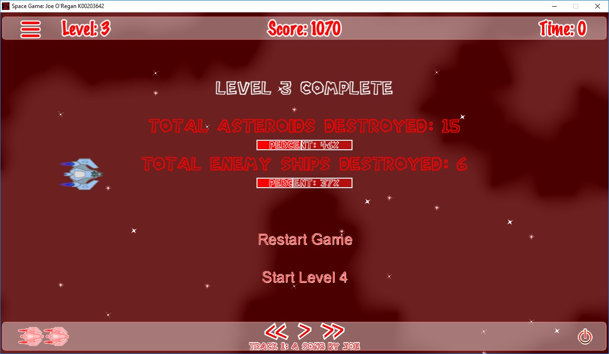

# Heads-Up Display (HUD)

The HUD provides the player with real-time telemetry layered above the game action.

---

## Display Components

* **Level Indicator**: Displays the currently active stage (`Level 1` or `Level 2`).
* **Score Counter**: Real-time numerical tally of accumulated points.
* **Game Timer**: Elapsed survival and completion timer.
* **Lives Icons**: Miniature ship silhouettes indicating remaining attempts.
* **Status Bars**: Visual colored health bars reflecting player energy and boss damage.
