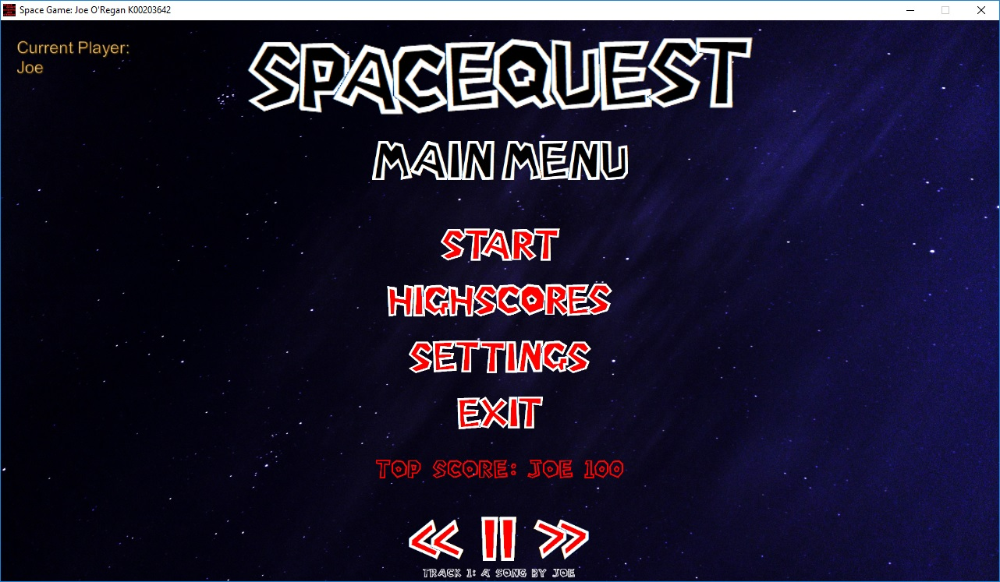

# In-Game Music Player & Audio Engine

Space Quest features an integrated interactive music controller powered by `CocosDenshion::SimpleAudioEngine`.

---

## Audio Features

* **Track Jukebox**: An on-screen panel allowing the player to cycle to the next or previous track.
* **Playback Controls**: Real-time Play, Pause, and Mute buttons.
* **Sound Effects**: Distinct audio cues for laser blasts, collisions, explosions, power-up collection, and boss alert sirens.
