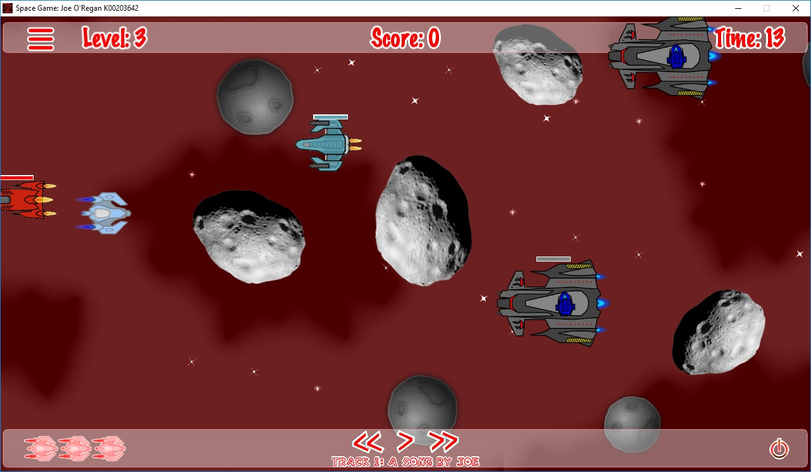

# Hostile Enemy Roster

The hostile armada consists of autonomous units with distinct movement algorithms and attack patterns.

---

## Unit Types

1. **Asteroids**: Neutral rotational hazards of variable size that damage anything in their path.
2. **Scout Drones**: Lightweight, fast-moving hostile craft executing wave trajectories.
3. **Attack Cruisers**: Heavy warships capable of firing targeted projectiles toward the player ship.
4. **DerpStar Boss**: Capital station equipped with multi-stage attack patterns and heavy armor.
