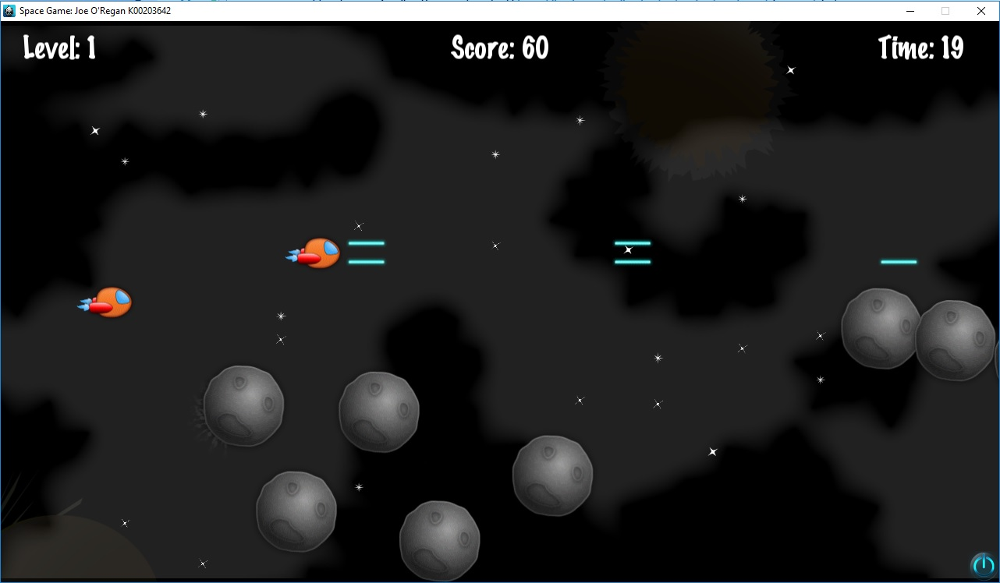

# Entities & Combat System

Entities in Space Quest inherit from Cocos2d-x `Sprite` and are coordinated within the physics and collision evaluation loop.

---

## Entity Architecture

* **[Player Ship](player.md)**: Kinematic player ship with multi-directional movement and dual laser cannons.
* **[Enemy Fleet](enemies.md)**: Asteroids, agile scout drones, heavy cruisers, and the final boss.
* **[Weapons & Power-ups](powerups.md)**: Single lasers, double lasers, shield replenishments, and extra life pickups.
