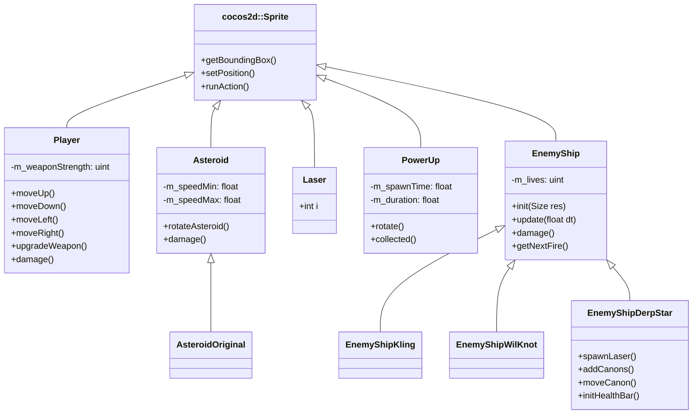

# Entities & Combat System

All combat entities in Space Quest inherit from `cocos2d::Sprite` (or `cocos2d::Node`) and interact via bounding-box collision detection, weapon upgrade matrices, and health bar overlays.

---

## 1. Class Inheritance & Entity Hierarchy

---

## 2. Combat System Architecture

### Player Ship & Weapon Upgrades
The kinematic player ship responds to desktop keyboard bindings or mobile virtual D-Pad coordinates:
* **Single Red Laser (Default)**: Rapid fire, linear trajectory dealing baseline damage to asteroids and scouts.
* **Double Lasers**: Unlocked via weapon power-up crates, firing twin parallel beams from wing cannons for double damage per salvo.
* **Invulnerability Flash**: Triggered upon collision damage via `stopFlashing(float time)` to protect the player during respawn.

### Enemy Fleet & Autonomous AI
* **Asteroids (`Asteroid`, `AsteroidOriginal`)**: Rotating kinematic hazards that cross the screen at randomized speeds between 2.0s and 10.0s.
* **Scout Cruisers (`EnemyShipKling`)**: Fast-moving attack ships with periodic laser barrages.
* **Heavy Interceptors (`EnemyShipWilKnot`)**: High-durability vessels requiring sustained laser fire.
* **DerpStar Capital Boss (`EnemyShipDerpStar`)**: Level 2 final boss featuring rotating laser cannons, multiple attack phases, and an on-screen boss health bar.

### Power-Ups & Collectables
* **Extra Life**: Awards an additional player life.
* **Weapon Upgrade**: Upgrades weapon strength from single to dual cannons.
* **Shield Buff**: Fully restores active player hit points via `HealthBar`.
