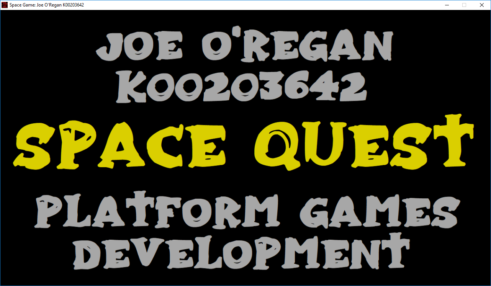

# Game Design Overview

The primary vision behind **Space Quest** is to create an engaging, arcade-style 2D side-scroller that delivers identical gameplay pacing and responsiveness across both desktop and mobile form factors.

---

## Core Philosophy

* **Instant Action**: The player is thrust directly into high-speed combat requiring sharp reflexes, dodging asteroids, and intercepting enemy flight formations.
* **Cross-Platform Parity**: The game architecture abstracts platform differences, ensuring that a touch player on Android enjoys the same precision as a keyboard player on Windows.
* **Visual Polish**: Fluid parallax background starfields, particle engine explosions, and animated status bars enhance player feedback.

!!! note "Design Goals"  
    1. Deliver 60 FPS performance across low-end mobile devices and desktop systems using Cocos2d-x sprite batching.
    2. Maintain clean separation between platform-specific input abstractions and core game state logic.
    3. Encourage replayability through persistent cloud high scores and Google Play achievement milestones.
