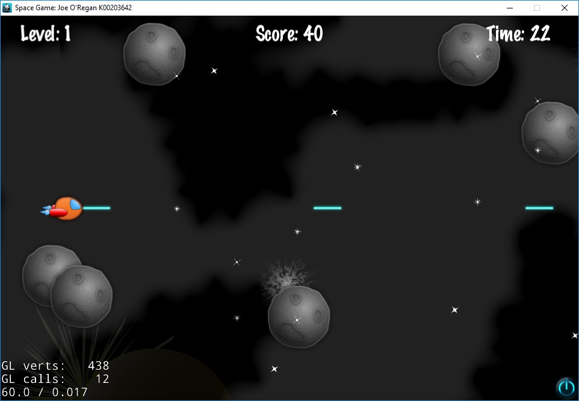

# Gameplay Mechanics & Rules

Space Quest combines classic shoot-'em-up (shmup) mechanics with modern power-up progression and multi-phase boss encounters.

---

## Core Rules

1. **Survival & Lives**:
   - The player begins each game with 3 lives represented by ship icons on the HUD.
   - Taking damage depletes the player's energy bar. Once depleted, a life is lost and the ship respawns with brief invulnerability frames.
2. **Scoring**:
   - Destroying hostile drones, cruisers, and asteroids awards points scaled by enemy difficulty.
   - A completion bonus is granted upon defeating the stage boss based on remaining time and lives.
3. **Stage Progression**:
   - **Level 1 (Asteroid Belt)**: High-density asteroid obstacles and agile drone scouts.
   - **Level 2 (Deep Space)**: Armed attack cruisers and the DerpStar capital boss.

!!! tip "Victory Conditions"  
    To complete the campaign, the player must survive both levels, withstand relentless attack waves, and destroy the DerpStar Boss before their lives are exhausted.
