# Space Quest: Platform Game Development

   
  <a href="https://joeoregan.github.io/JS-SpaceQuest/" alt="SpaceQuestJS Link">Play Space Quest JS</a>

**Space Quest** is a cross-platform 2D side-scrolling space shooter developed in C++ using the **Cocos2d-x** framework for **Win32 (Windows)** and **Android**. The project was created as part of the Year 4 Platform Games Development module in the BSc (Honours) in Computing (Games Design & Development) at Limerick Institute of Technology (LIT).

!!! tip "Project Overview"  
    * **Engine**: Cocos2d-x (C++11) with multi-resolution asset scaling.
    * **Target Platforms**: Win32 (Visual Studio) and Android (Android Studio / NDK).
    * **Services**: Google Analytics and Google Play Games Services integrated via **SDKBox**.
    * **Input**: Dual desktop keyboard bindings and mobile capacitive multi-touch virtual D-Pad.

---

## Gameplay Trailer

  
  
<em>Watch the Space Quest gameplay trailer on YouTube</em>

---

## Core Additions & Enhancements

* **Enhanced Combat**: Single lasers upgradeable to high-velocity **Double Lasers** and shield buffs.
* **Autonomous Enemies**: Rotational asteroid hazards, evasive scout drones, heavy cruisers, and the multi-phased **DerpStar Boss**.
* **Dual Control Schemes**: Keyboard input on desktop and an on-screen **EasyArrowsx-3.0** virtual D-Pad on mobile.
* **In-Game Music Player**: Custom interactive audio controller allowing real-time track cycling, pausing, and volume modulation.
* **Full HUD**: Real-time rendering of health status bars, remaining lives, game timer, active level, and cumulative score.
* **SDKBox Integration**: Live session analytics and persistent cloud **Leaderboards & Achievements** via Google Play Games.

---

## Documentation Contents

- **[Game Design](game-design/index.md)**: Design philosophy, cross-platform goals, and gameplay rules.
- **[Architecture](architecture/index.md)**: Cocos2d-x scene graph, input abstraction, and SDKBox cloud telemetry.
- **[Scenes & Levels](scenes/index.md)**: Parallax background starfield, Level 1, and Level 2 Boss showdown.
- **[Entities & Combat](entities/index.md)**: Player ship, enemy fleet roster, weapons, and pickups.
- **[Audio & UI](audio-ui/hud.md)**: Heads-Up Display metrics and the in-game music jukebox.
- **[Build & Setup](setup/win32.md)**: Development setup for Win32 Visual Studio and Android Studio.
