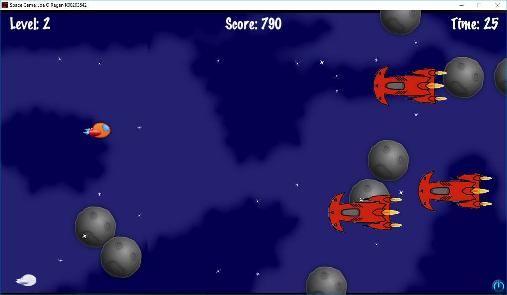

# Scenes & Level Progression

The gameplay flow in Space Quest progresses across distinct scenes managed by the Cocos2d-x `Director`.

---

## Scene Flow Overview

1. **Splash & Title Scene**: Displays animated logos and checks SDKBox cloud authentication.
2. **Main Menu Scene**: Provides entry points for Start Game, High Scores, Settings, and Instructions.
3. **Gameplay Scenes**:
   - **[Level 1](level-1.md)**: Asteroid Belt & scouting drones.
   - **[Level 2 & Boss](level-2.md)**: Deep Space combat & the DerpStar capital ship.
4. **Outcome Scenes**:
   - **Level Complete**: Displays bonus tallies and stage completion badges.
   - **Game Over**: Presents final score, high score comparison, and retry options.
