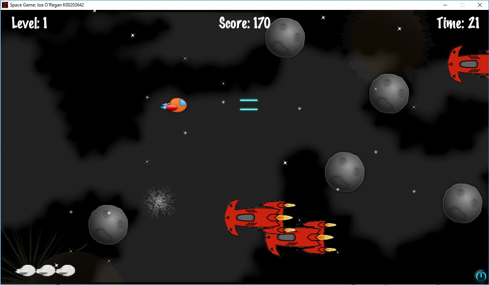

# Level 1: Asteroid Field

Level 1 introduces the player to basic movement, laser weapons, and collision hazards within an asteroid belt.

---

## Stage Characteristics

* **Environment**: High-speed asteroid field with rotating rock hazards of varying scale.
* **Hostile Units**: Light Scout Drones navigating in erratic sine-wave patterns.
* **Objectives**:
  * Navigate through dense asteroid clusters without depleting ship shields.
  * Destroy incoming scout formations to harvest score points and weapon power-ups.
  * Survive until the jump beacon coordinates are reached to trigger the Level 2 warp.
