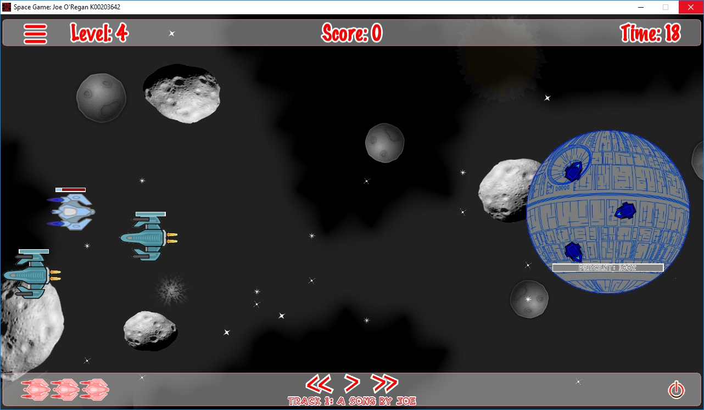

# Level 2 & The DerpStar Boss

Level 2 shifts the battle into deep space, escalating the difficulty with armed combat cruisers and the final boss encounter.

---

## The DerpStar Boss Encounter

The **DerpStar** is a massive capital station featuring multi-phased combat logic:

1. **Phase 1 (Turret Barrage)**: The station fires periodic energy bolts while deploying escort drones.
2. **Phase 2 (Shield Overload)**: Once damaged past 50% health, the boss activates a protective barrier requiring tactical repositioning.
3. **Phase 3 (Enraged Fire)**: Accelerated fire rate with rotating spread patterns.

!!! important "Boss Victory Condition"  
    Depleting the DerpStar's health bar triggers a massive particle explosion, unlocks the "DerpStar Slayer" achievement, and marks the game as completed.
